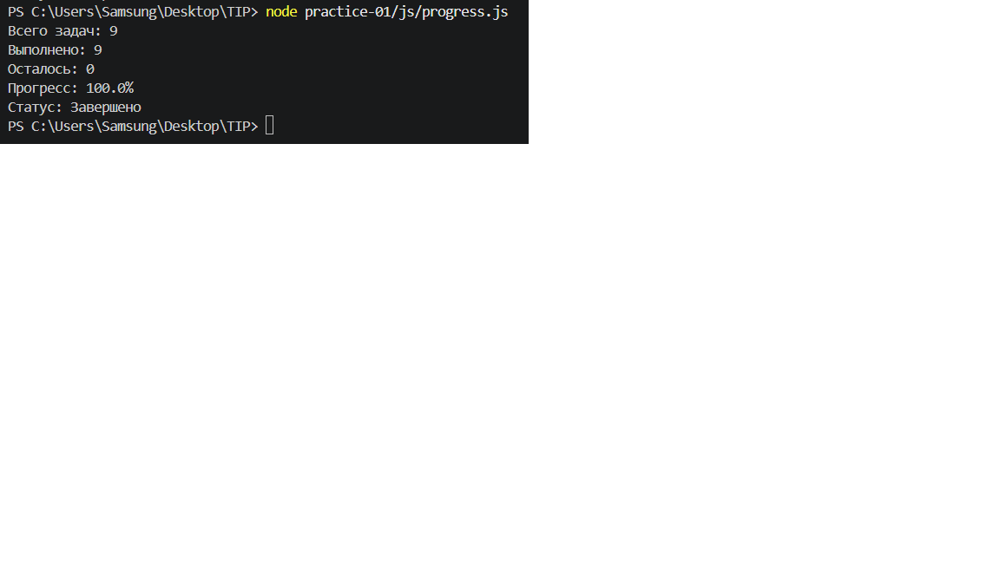
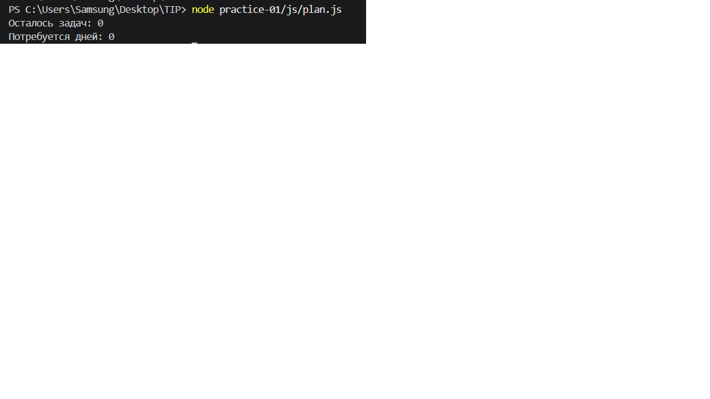
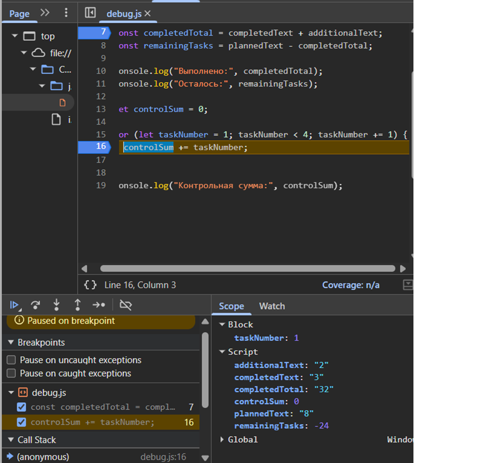
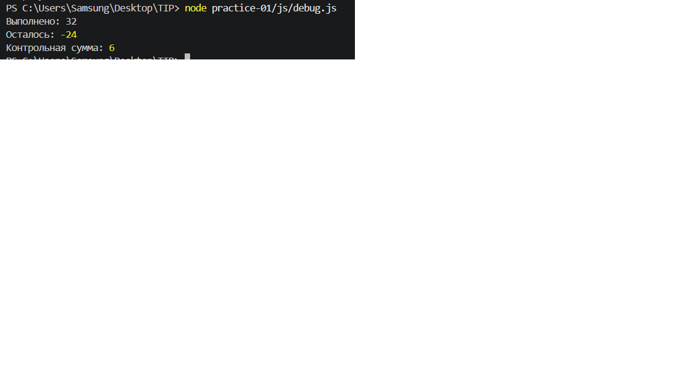

# Практическая работа № 1

**Тема:** Подготовка окружения и первые программы на JavaScript

**Дисциплина:** Технологии индустриального программирования

**Автор:** Какурина Софья 
**Группа:** Эфбо-12-25 
**Вариант:** 3

---

## 1. Окружение

| Инструмент | Версия |
|---|---|
| Операционная система | Windows 11 Домашняя |
| Node.js | v24.21.0 |
| npm | 11.19.0 |
| Git | 2.56.0.windows.2 |
| Браузер | Firefox / Chrome (укажите свой) |
| Редактор | Visual Studio Code |

---

## 2. Запуск

Все команды выполняются из корня репозитория `TIP`.

### Запуск в Node.js

```bash
node practice-01/js/hello.js
node practice-01/js/types.js
node practice-01/js/progress.js
node practice-01/js/plan.js
node practice-01/js/debug.js

## 5. Задание 3. Сводка выполнения задач

**Входные данные (вариант 3):** `totalTasks = 9`, `completedTasks = 9`.

### Результат для варианта 3

Всего задач: 9
Выполнено: 9
Осталось: 0
Прогресс: 100.0%
Статус: Завершено


### Таблица проверок

| Проверка | `totalTasks` | `completedTasks` | Ожидаемый результат | Фактический результат | Итог |
|---|---|---|---|---|---|
| Обычный случай | 12 | 5 | Осталось 7; 41.7%; В работе | Осталось 7; 41.7%; В работе | Пройдено |
| Нет задач | 0 | 0 | Задач пока нет | Задач пока нет | Пройдено |
| Ничего не сделано | 5 | 0 | Осталось 5; 0.0%; Не начато | Осталось 5; 0.0%; Не начато | Пройдено |
| Всё выполнено | 5 | 5 | Осталось 0; 100.0%; Завершено | Осталось 0; 100.0%; Завершено | Пройдено |
| Больше, чем есть | 5 | 6 | Ошибка | Ошибка: недопустимые данные | Пройдено |
| Отрицательное | -1 | 0 | Ошибка | Ошибка: недопустимые данные | Пройдено |
| Дробное | 5 | 2.5 | Ошибка | Ошибка: недопустимые данные | Пройдено |
| Строка вместо числа | "5" | 2 | Ошибка | Ошибка: недопустимые данные | Пройдено |
| Больше 1000 | 1001 | 0 | Ошибка | Ошибка: недопустимые данные | Пройдено |
| NaN | NaN | 0 | Ошибка | Ошибка: недопустимые данные | Пройдено |
| **Мой вариант** | **9** | **9** | Осталось 0; 100.0%; Завершено | Осталось 0; 100.0%; Завершено | Пройдено |

### Скриншот вывода progress.js




### Таблица проверок

| Проверка | `totalTasks` | `completedTasks` | `dailyLimit` | Ожидаемый результат | Фактический результат | Итог |
|---|---|---|---|---|---|---|
| Обычный случай | 12 | 5 | 3 | 3 дня | 3 дня | Пройдено |
| Ровно по дням | 10 | 4 | 3 | 2 дня | 2 дня | Пройдено |
| Лимит больше остатка | 5 | 3 | 10 | 1 день, 2 задачи | 1 день, 2 задачи | Пройдено |
| Всё выполнено | 5 | 5 | 2 | 0 дней | 0 дней | Пройдено |
| Нет задач | 0 | 0 | 2 | 0 дней | 0 дней | Пройдено |
| Лимит 0 | 5 | 2 | 0 | Ошибка | Ошибка: недопустимые данные | Пройдено |
| Дробный лимит | 5 | 2 | 1.5 | Ошибка | Ошибка: недопустимые данные | Пройдено |
| Выполнено больше | 5 | 6 | 2 | Ошибка | Ошибка: недопустимые данные | Пройдено |
| Лимит строкой | 5 | 2 | "2" | Ошибка | Ошибка: недопустимые данные | Пройдено |
| Лимит > 1000 | 5 | 2 | 1001 | Ошибка | Ошибка: недопустимые данные | Пройдено |
| **Мой вариант** | **9** | **9** | **3** | 0 дней | 0 дней | Пройдено |

### Скриншот вывода plan.js



## 7. Задание 5. Поиск логических ошибок через DevTools

### Исходный вывод (с ошибками)

Выполнено: 32
Осталось: -24
Контрольная сумма: 6


### Вывод после исправления

Выполнено: 5
Осталось: 3
Контрольная сумма: 10


### Таблица ошибок

| Ошибка | Что наблюдалось | Причина | Исправление | Результат после исправления |
|---|---|---|---|---|
| Обработка количества задач | `completedTotal = "32"` (строка), `remainingTasks = -24` | Оператор `+` со строками выполняет конкатенацию, а не сложение. `"3" + "2" = "32"`. Затем `"8" - "32"` даёт `-24`, потому что `-` преобразует строки в числа. | Заменить `completedText + additionalText` на `Number(completedText) + Number(additionalText)` | `completedTotal = 5`, `remainingTasks = 3` |
| Граница цикла | `controlSum = 6` (вместо `10`) | Условие `taskNumber < 4` останавливает цикл на значении `3`. Число `4` не попадает в сумму. | Заменить `taskNumber < 4` на `taskNumber <= 4` | `controlSum = 10` |

### Иллюстрация точки останова



### Скриншот исправленного вывода debug.js



## 8. Вывод

В ходе практической работы я:

1. Подготовил рабочее окружение: установил Node.js (v24.21.0), Git (2.56.0), настроил VS Code и проверил их работу через терминал.
2. Научился запускать JavaScript в двух средах: через Node.js (в терминале) и в браузере (через Console DevTools). Убедился, что один и тот же файл работает в обеих средах, но с разным результатом для `typeof document`.
3. Разобрался с типами данных JavaScript: `number`, `string`, `boolean`, `undefined`, `null`, а также с особенностями `NaN` и `typeof null`.
4. Исследовал преобразование типов: конкатенация строк через `+`, автоматическое преобразование через `-`, явное преобразование через `Number()` и `Boolean()`.
5. Реализовал сводку выполнения задач (Задание 3) с полной проверкой входных данных: типы, целочисленность, диапазоны, логические ограничения.
6. Реализовал пошаговый план выполнения задач (Задание 4) с использованием цикла `while`, ограничения `dailyLimit` и корректной обработки последнего дня через `Math.min()`.
7. Научился находить логические ошибки через отладчик (DevTools): точка останова, пошаговое выполнение, просмотр значений и типов переменных в панели Scope.
8. Закрепил навыки работы с Git: инициализация репозитория, настройка автора, коммиты, отслеживание изменений.

### Наиболее показательная ошибка

Наиболее показательной оказалась **первая ошибка в Задании 5** — неявное преобразование типов при сложении строк:

```js
const completedTotal = completedText + additionalText;
// "3" + "2" = "32" (строка), а не 5 (число)